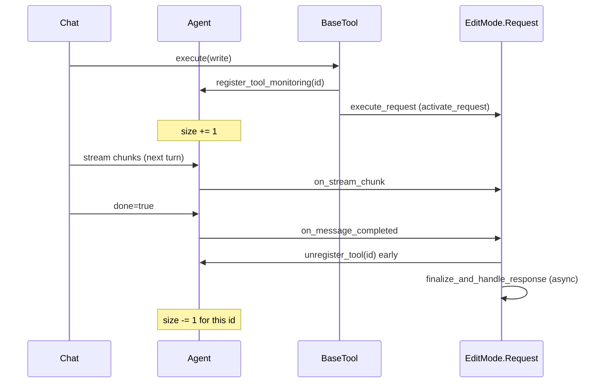

# `Agent.active_tools` grows during edit-mode / bash tool loops

**Status:** ⏳ OPEN — anatomy and proposals documented; no product fix yet.

**Started:** 2026-11-20

**Pointer:** `docs/bug-fix-process.md`

**Related:**

- [2026-11-20-desktop-write-file-edit-loop.md](2026-11-20-desktop-write-file-edit-loop.md) — gtktest1 session; model keeps calling `write` with no fences (why many tool rounds).
- [2026-11-20-edit-mode-stream-handler-criticals.md](2026-11-20-edit-mode-stream-handler-criticals.md) — failed `write` left a monitor subscribed until `RequestBase` unregister fix.

## Problem

- 🔷 During the gtktest1 Agent Pi run (2026-11-20), debug log showed `active_tools.size` rising from **2** toward **11** while the agent alternated `write` and `bash` without finishing edit mode.
- 🔷 Expected: at most **one** edit-mode stream monitor per file while the assistant is supposed to emit fences; finished one-shot tools (e.g. a short `bash` that already returned output) should not stay in `active_tools` forever.
- 🔷 Actual: the map accumulated many request ids over ~2 minutes; user stop at **09:15:20** cancelled a large set of in-flight work.

## What `active_tools` is (plain language)

- ℹ️ **`Agent.Base.active_tools`** is `Gee.HashMap<int, RequestBase>` — keyed by auto-increment **`request_id`** on each tool invocation.
- ℹ️ On every tool run, **`BaseTool.execute`** calls **`register_tool_monitoring`** *before* `request.execute()` (`libollmchat/Tool/BaseTool.vala` ~280). That:
  - stores the request in the map;
  - connects **`on_stream_chunk`** and **`on_message_completed`** on the agent (for tools that override them).
- ℹ️ **`unregister_tool`** removes the entry and disconnects those signals.

**Two features share this map:**

| Use | Who needs it | When it should leave the map |
|-----|----------------|-------------------------------|
| Edit-mode fence capture | `write` (`EditMode.Request`) | After the assistant message that should contain fences completes (see below). |
| Per-frame **Stop** on shell tools | `bash` / `run_command` (`RunCommand.Request`) | After the command finishes (or when the user stops it). |

The gtktest1 log line prints **`active_tools.size`** from **`Agent.handle_stream_chunk`** when `response.done=true` — that is “how many requests are still hooked to the agent right now,” not “how many bash processes are running.”

## Two lists (easy to conflate)

- ℹ️ **`Agent.active_tools`** — agent-wide signal subscriptions (`register_tool_monitoring`).
- ℹ️ **`EditMode.Tool.active_requests`** — edit-tool list of live `EditMode.Request` objects (`activate_request` / `reply_with_errors` cleanup). Same session shows repeated `Tool.activate_request: Cleaning up existing request for file …` while the model re-called `write`.

Only the **agent** map size appears in the gtktest1 `active_tools.size=…` lines.

## Evidence (gtktest1)

- ℹ️ Same logs as [edit-loop bug](2026-11-20-desktop-write-file-edit-loop.md).
- ✔️ **09:13:23–09:13:40** — many cycles: `message_completed` with **`active_tools.size=1`**, `content_total=0`, then another `Executing tool 'write'` and `Cleaning up existing request for file …/test-file.txt`. One edit monitor per assistant turn; model re-activated edit mode without fences.
- ✔️ **09:13:51–09:15:15** — **`active_tools.size`** climbs **2 → 7 → 11** as the model mixes more `write` and **`bash`** rounds.
- ✔️ **09:15:20** — stop/cancel; burst of `Request.reply_with_errors: Removed request from active_requests`.

## Lifecycle (edit-mode `write` — normal path)



- ✔️ **`on_message_completed`** unregisters **before** async finalize (`EditMode.Request.vala` ~349), so another `write` on the **next** tool round does not need two edit monitors for the same turn-ending stream.

## Root cause (confirmed vs suspected)

### 1. One-shot tools stay registered after `execute` returns — ✔️ confirmed in code

- ✔️ **`BaseTool.execute`** always registers; only **`unregister_tool`** call sites in the tree are edit-mode paths, permission/throw in **`RequestBase.execute`**, and **`EditMode.Tool.activate_request`** cleanup for the **previous** same-file id.
- ✔️ **`RunCommand.Request`** overrides **`execute()`** end-to-end and **never** calls **`unregister_tool`** when the command finishes (`liboctools/RunCommand/Request.vala`). Prior bugs note this was incidental ([`2026-11-06-FIXED-stop-one-tool.md`](done/2026-11-06-FIXED-stop-one-tool.md) planned §2 lifecycle; still open for unregister-after-done).
- 💩 Each completed **`bash`** in gtktest1 likely leaves its request id in the map until session end. Many bash verify/rewrite calls explain much of the **2 → 11** climb together with any other tools that registered once.

### 2. Failed `write` before monitoring teardown — ✔️ fixed elsewhere

- ✔️ Invalid `edit_mode` registered then threw with no **`activate_request`**; failed id was **not** on `EditMode.Tool.active_requests`, so replacement `write` did not unregister it. **`RequestBase.execute`** now unregisters on throw/deny ([stream-handler bug](2026-11-20-edit-mode-stream-handler-criticals.md)).

### 3. Edit-mode re-call loop — ✔️ symptom amplifier, not the map-growth mechanism

- ✔️ Model kept calling **`write`** with empty assistant body ([edit-loop bug](2026-11-20-desktop-write-file-edit-loop.md)). That churns **`active_requests`** and repeats register/unregister for **successful** writes (~1 id during each fence stream turn).
- ℹ️ That loop alone does **not** explain **11** simultaneous ids if every successful write unregisters on the next `message_completed`; sustained high counts point at **leaked** registrations (mostly finished **bash** / other non-streaming tools).

### 4. `activate_request` vs async finalize — ℹ️ misunderstood as “stacking monitors”

- ℹ️ **`activate_request`** calls **`unregister_tool`** on the **previous** same-file request id and drops it from **`active_requests`**. It does **not** wait for **`finalize_and_handle_response`** or **`reply_with_errors`**.
- 💩 That can tear down edit state while finalize still runs, but the **previous** id is usually already **unregistered** in **`on_message_completed`**. This is ordering / apply correctness (overlap with stream-handler §3), not the main reason **`active_tools.size`** hits **11**.

## Proposed fix

### 1. Unregister `run_command` when the child is done — 🔷 primary for map growth

**Where:** `liboctools/RunCommand/Request.vala` — `finally` block of `execute()` (after `execute_tool_async` returns), or when `child_active` becomes false.

**Behavior:**

- 🔷 Call **`this.agent.unregister_tool(this.request_id)`** once the command has finished and output has been returned to the model — **not** while the user might still press Stop on a live frame.
- 🔷 If Stop must keep working on completed frames, narrow frame Stop to “no-op when already finished” instead of keeping every id forever (product choice).

#### Add (sketch — verify against surrounding `finally`)

```vala
				this.agent.unregister_tool(this.request_id);
```

(place after command is fully done, child joined, notifications sent)

### 2. Default unregister for non-streaming tools — 💩 optional uniform policy

**Where:** `libollmchat/Tool/BaseTool.vala` or `RequestBase.execute`.

- 💩 After successful **`execute_request`**, if the request did **not** opt into stream monitoring (e.g. no override of `on_message_completed` / explicit flag), call **`unregister_tool`** in **`RequestBase.execute`** before returning.
- 🚫 Do not unregister edit-mode requests there — they must stay connected until **`on_message_completed`**.

### 3. Harness guard on duplicate `write` — 🔷 edit-loop; stops churn

**Where:** edit-loop bug — reject a second `write` for the same path while edit mode is already active. Reduces rounds and repeated **`register_tool_monitoring`**, not a substitute for (1).

### 4. Instrumentation for next capture — 💩

- 💩 Log **`request_id`**, tool name, and **`active_tools.size`** at **`register_tool_monitoring`** / **`unregister_tool`** when **`G_MESSAGES_DEBUG`** / `--debug`, to separate “bash leak” vs “edit-mode stuck registered” on the next reproduction.

## Attempts / changelog

- ✔️ 2026-11-20 — Split from edit-loop and stream-handler bug logs after user asked for a dedicated doc for **`active_tools`** stacking.
- ✔️ 2026-11-20 — Traced `BaseTool.execute`, `Agent.register_tool_monitoring`, `EditMode.Request.on_message_completed`, `RunCommand.Request.execute` (no unregister).

## Next

- ⏳ 🔷 Implement (1) and re-run gtktest1-style loop; expect **`active_tools.size`** to stay low (0–1 during fence stream, not monotonic growth across finished bash calls).
- ⏳ 💩 Decide Stop semantics for completed shell frames vs unregister-after-done.
- ⏳ ℹ️ Keep duplicate-`write` guard in [edit-loop bug](2026-11-20-desktop-write-file-edit-loop.md).