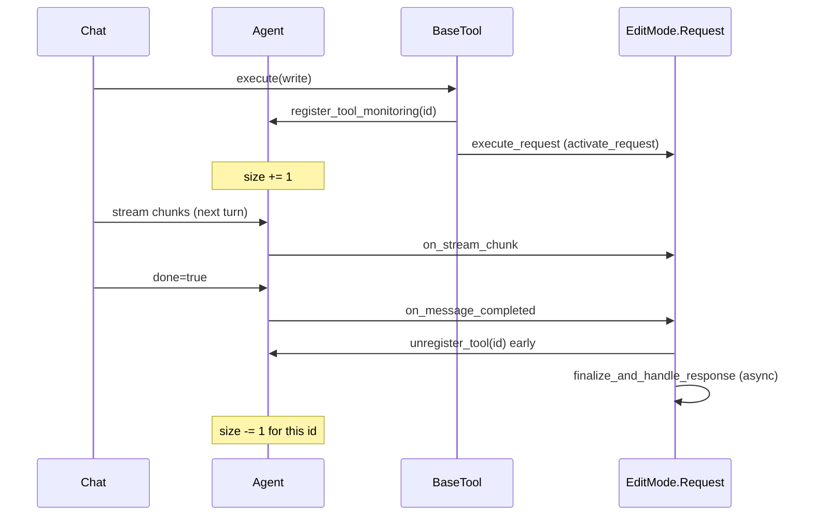

# `monitored_requests` map growth (was `active_tools`)

**Status:** ✅ 2026-11-21. User closed. Renamed agent map to `monitored_requests`; `run_command` and `bash` unregister when the shell run ends (detached bash on daemon `finished`). Stop on a finished frame no-ops when the id is gone (`ChatView` already checks `has_key`).

**Started:** 2026-11-20

**Pointer:** `docs/bug-fix-process.md`

**Related:**

- [2026-11-20-desktop-write-file-edit-loop.md](2026-11-20-FIXED-desktop-write-file-edit-loop.md) — gtktest1 session; model keeps calling `write` with no fences (why many tool rounds).
- [2026-11-21-FIXED-edit-mode-stream-handler-criticals.md](2026-11-21-FIXED-edit-mode-stream-handler-criticals.md) — failed `write` stream monitor; fixed with `defer_stream_monitor` + API rename.

## Problem

- 🔷 During the gtktest1 Agent Pi run (2026-11-20), debug log showed map size rising from **2** toward **11** while the agent alternated `write` and `bash` without finishing edit mode.
- 🔷 Expected: at most **one** edit-mode stream monitor per file while the assistant is supposed to emit fences; finished one-shot tools (e.g. a short `bash` that already returned output) should not stay in the map forever.
- 🔷 Actual: the map accumulated many request ids over ~2 minutes; user stop at **09:15:20** cancelled a large set of in-flight work.

## What the map is (plain language)

- ℹ️ **`Agent.Base.monitored_requests`** (formerly `active_tools`) is `Gee.HashMap<int, RequestBase>` — keyed by auto-increment **`request_id`** on each tool invocation.
- ℹ️ On every tool run, **`BaseTool.execute`** calls **`register_tool_monitoring`** *before* `request.execute()` (`libollmchat/Tool/BaseTool.vala` ~280). That:
  - stores the request in the map;
  - connects **`on_stream_chunk`** and **`on_message_completed`** on the agent (for tools that override them).
- ℹ️ **`unregister_tool`** removes the entry and disconnects those signals.

**Two features share this map:**

| Use | Who needs it | When it should leave the map |
|-----|----------------|-------------------------------|
| Edit-mode fence capture | `write` (`EditMode.Request`) | After the assistant message that should contain fences completes (see below). |
| Per-frame **Stop** on shell tools | `bash` / `run_command` (`RunCommand.Request`) | After the command finishes (or when the user stops it). |

The gtktest1 log line printed map size from **`Agent.handle_stream_chunk`** when `response.done=true` — “how many requests are still hooked to the agent,” not “how many bash processes are running.”

## Two lists (easy to conflate)

- ℹ️ **`Agent.monitored_requests`** — agent-wide signal subscriptions (`register_tool_monitoring`).
- ℹ️ **`EditMode.Tool.active_requests`** — edit-tool list of live `EditMode.Request` objects (`activate_request` / `reply_with_errors` cleanup). Same session shows repeated `Tool.activate_request: Cleaning up existing request for file …` while the model re-called `write`.

Only the **agent** map size appears in the gtktest1 size=… lines.

## Evidence (gtktest1)

- ℹ️ Same logs as [edit-loop bug](2026-11-20-FIXED-desktop-write-file-edit-loop.md).
- ✔️ **09:13:23–09:13:40** — many cycles: `message_completed` with **size=1**, `content_total=0`, then another `Executing tool 'write'` and `Cleaning up existing request for file …/test-file.txt`. One edit monitor per assistant turn; model re-activated edit mode without fences.
- ✔️ **09:13:51–09:15:15** — size climbs **2 → 7 → 11** as the model mixes more `write` and **`bash`** rounds.
- ✔️ **09:15:20** — stop/cancel; burst of `Request.reply_with_errors: Removed request from active_requests`.

## Lifecycle (edit-mode `write` — normal path)

- ✔️ **`on_message_completed`** unregisters **before** async finalize (`EditMode.Request.vala` ~349), so another `write` on the **next** tool round does not need two edit monitors for the same turn-ending stream.

## Root cause (confirmed vs suspected)

### 1. One-shot tools stay registered after `execute` returns — ✔️ confirmed; ✔️ fixed

- ✔️ **`RunCommand.Request`** and **`Bash.Request`** registered for Stop but did not **`unregister_tool`** when the command finished — gtktest1 **2 → 11** climb.
- ✔️ **Fix:** `unregister_tool` in each tool’s existing `execute()` `finally` after `client.run_tool.end`; detached bash on daemon **`finished`** (`liboctools/RunCommand/Request.vala`, `liboctools/Bash/Request.vala`).

### 2. Failed `write` before monitoring teardown — ✔️ fixed elsewhere

- ✔️ Edit failed `write` stream criticals — fixed in [stream-handler bug](2026-11-21-FIXED-edit-mode-stream-handler-criticals.md) (`defer_stream_monitor`, not early subscribe).

### 3. Edit-mode re-call loop — ✔️ symptom amplifier, not the map-growth mechanism

- ✔️ Tracked in [edit-loop bug](2026-11-20-FIXED-desktop-write-file-edit-loop.md).

### 4. `activate_request` vs async finalize — ℹ️ ordering elsewhere

- ℹ️ Overlap with stream-handler §3, not the main reason size hit **11**.

## Fix applied

### 1. Rename + shell unregister — ✔️

- ✔️ `Agent.Base.active_tools` → **`monitored_requests`** (`libollmchat/Agent/Base.vala`); callers updated (`ChatView`, `Session`, `Render` docblock).
- ✔️ **`RunCommand.Request`:** `this.agent.unregister_tool(this.request_id)` in existing `finally` after notifications.
- ✔️ **`Bash.Request`:** same when not `detached`; `req.agent.unregister_tool` on detached **`finished`**.

### 2. Default unregister for all non-streaming tools — 🚫 out of scope

- 🚫 Not implemented; only shell tools were leaking in gtktest1 evidence.

### 3. Duplicate `write` guard — ℹ️ separate bug

- ℹ️ [edit-loop bug](2026-11-20-FIXED-desktop-write-file-edit-loop.md).

### 4. Extra register/unregister instrumentation — 🚫 deferred

- 🚫 Optional; reopen if map growth reproduces without finished bash in the loop.

## Attempts / changelog

- ✔️ 2026-11-20 — Split from edit-loop and stream-handler bug logs after user asked for a dedicated doc for map stacking.
- ✔️ 2026-11-20 — Traced `BaseTool.execute`, `Agent.register_tool_monitoring`, `EditMode.Request.on_message_completed`, `RunCommand.Request.execute` (no unregister).
- ✔️ 2026-11-21 — Renamed `monitored_requests`; shell unregister as above; user closed bug.